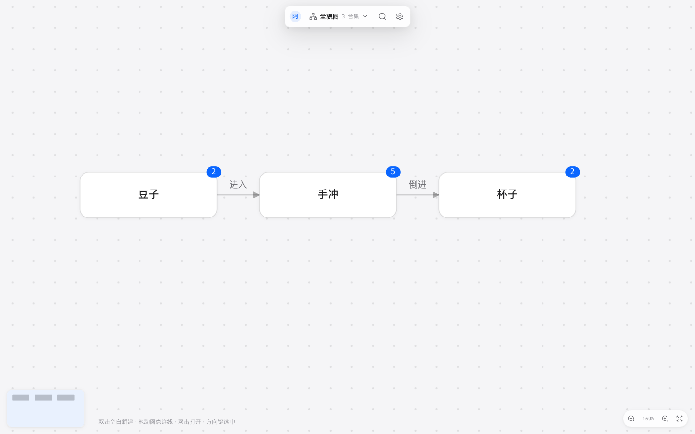
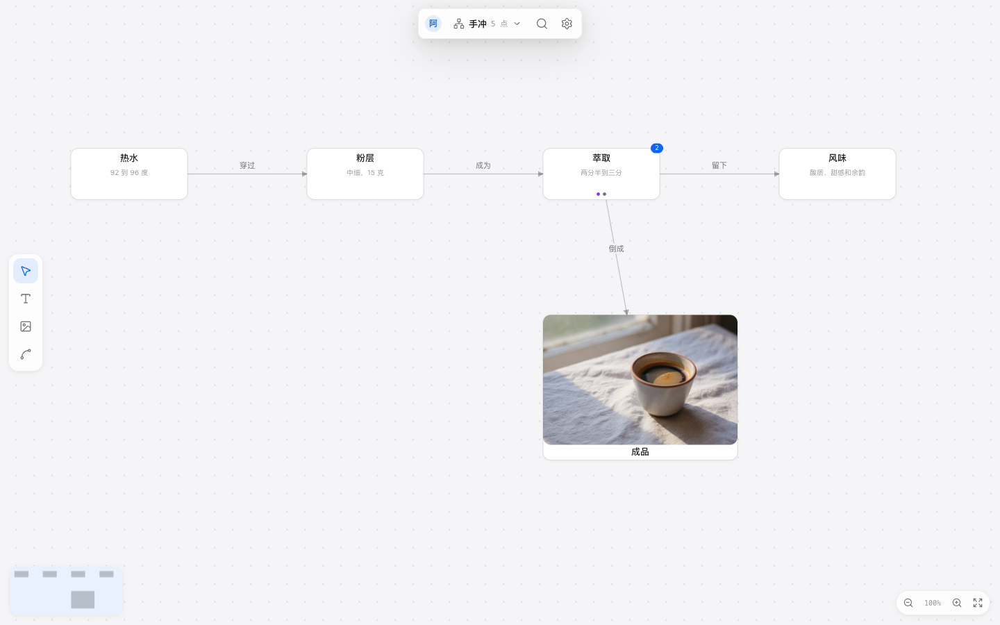
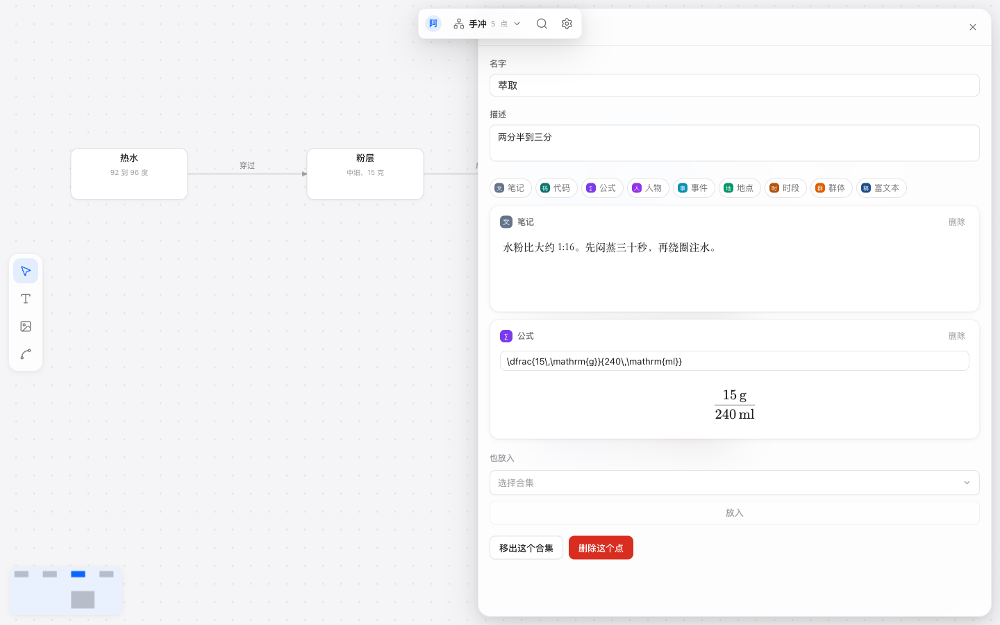

# Unfold

对某个领域进行深度学习时使用， Unfold 用来把概念和它们之间的关系展开。你在画板上摆放，用自己的话把它们连起来。

在浏览器打开 [unfold.aimo.plus](https://unfold.aimo.plus)，用用户名和密码注册。注册完直接进入。

也可以装桌面客户端。窗口里是同一个网站，网站更新了不用重装。安装包在 [桌面版 v0.1.0](https://github.com/ximing/unfold/releases/tag/desktop-v0.1.0)：

- [Windows](https://github.com/ximing/unfold/releases/download/desktop-v0.1.0/Unfold_0.1.0_x64-setup.exe)
- [macOS（Apple 芯片）](https://github.com/ximing/unfold/releases/download/desktop-v0.1.0/Unfold_0.1.0_aarch64.dmg)
- [macOS（Intel）](https://github.com/ximing/unfold/releases/download/desktop-v0.1.0/Unfold_0.1.0_x64.dmg)

下文的 ⌘ 在 Windows 和 Linux 上是 Ctrl。

## 图上四个基础概念

**合集**是一块画板，只有标题。新建的时候不必先有内容。合集之间可以连线。

**点**是一个概念。脸上是文字，或者一张图片。可以加一句短描述。名字可以重复。同一个点可以放进多个合集，每个合集里的位置分开记。从一个合集里移出，这个点还在。换掉图片后，其他合集里看到的也是新图。

**边**有方向。标签是你写的一句短话，比如「穿过」「进入」。同一对端点上，标签不同就可以有多条边。合集和合集之间也用这套规则。

**卡片**挂在点或边上，把这个概念写开。笔记、代码、公式、人物、事件、地点、时段、群体，点和边都能加。富文本是长文，写在点上。卡片建好之后类型就定了，内容可以改。

## 全貌

登录后先看到全貌图：全部合集，以及合集之间的关系。角上的数字是这个合集里有几个点。双击合集打开它。全貌上的位置是自动排的。

双击空白，或按 ⌘N，新建合集。顶部可以在合集之间切换，也能回到全貌。

## 合集画板

打开合集之后，位置由你摆。拖动一个点，松手就记下，刷新之后还在那里。

左侧是工具：

| 工具 | 键 | 做什么 |
| --- | --- | --- |
| 选择 | V | 点选、拖动、拖着空白处平移 |
| 文字 | T | 再点空白处，写下名字 |
| 图片 | I | 选一张图，放在视野中间 |
| 连线 | L | 从一个点连到另一个点 |

双击空白也会新建文字点。图片可以拖进画布，或在画布上按 ⌘V。格式是 JPEG、PNG、WebP、GIF，单张不超过 10 MB。

连线时，从点右侧的圆点拖到另一个点，写下标签才算连上。双击一条边可以改标签。

选中一个点时，Tab 在右侧新建下级，Enter 在下方新建同级。方向键按远近挪到旁边的点。Esc 取消正在做的事。

滚轮平移。捏合，或按着 ⌘ 滚动，用来缩放。右下角也可以缩放和适应屏幕。

## 卡片

点开一个点，右侧改名字和描述，并给它加卡片。下面是「萃取」上的一张笔记和一条公式。上面那一排是可以添加的种类。

| 卡片 | 用来写 |
| --- | --- |
| 笔记 | 短文 |
| 代码 | 一段源码，带语言 |
| 公式 | LaTeX |
| 人物 | 身份和备注 |
| 事件 | 时间、地点、经过 |
| 地点 | 备注 |
| 时段 | 起止和备注 |
| 群体 | 备注 |
| 富文本 | 长文：标题、列表、表格、代码、公式和图片。写在点上 |

笔记在离开输入框后保存。富文本停笔大约一秒后保存。点开一条边，也可以给这条关系加卡片。

## 搜索

按 ⌘K，或点顶部的搜索。它找点的名字，以及点上卡片里的文字。找到之后，如果这个点还在某个合集里，就打开那个合集并选中它。

头像里可以换头像、改用户名、退出。

## 开发

要在本机跑起来、改代码或发布，从 [开发说明](docs/README.md) 进入。
