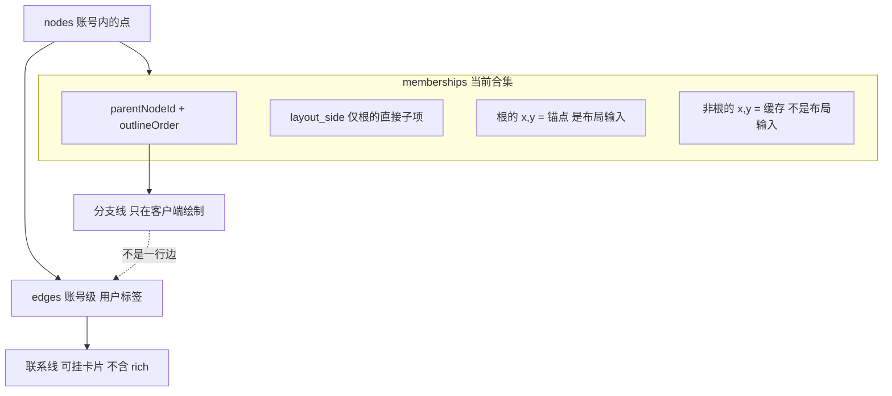
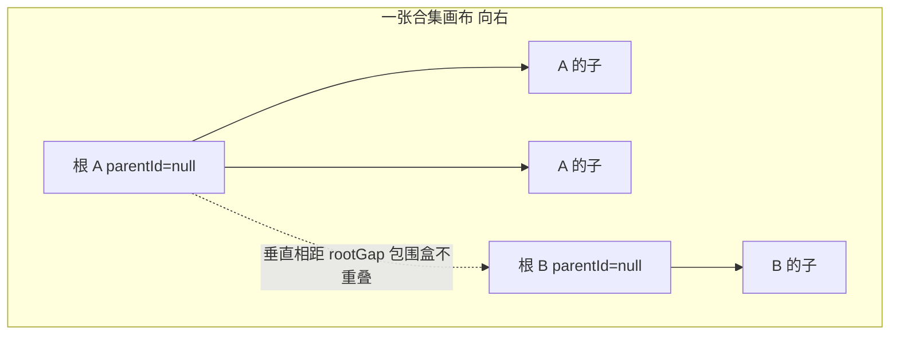
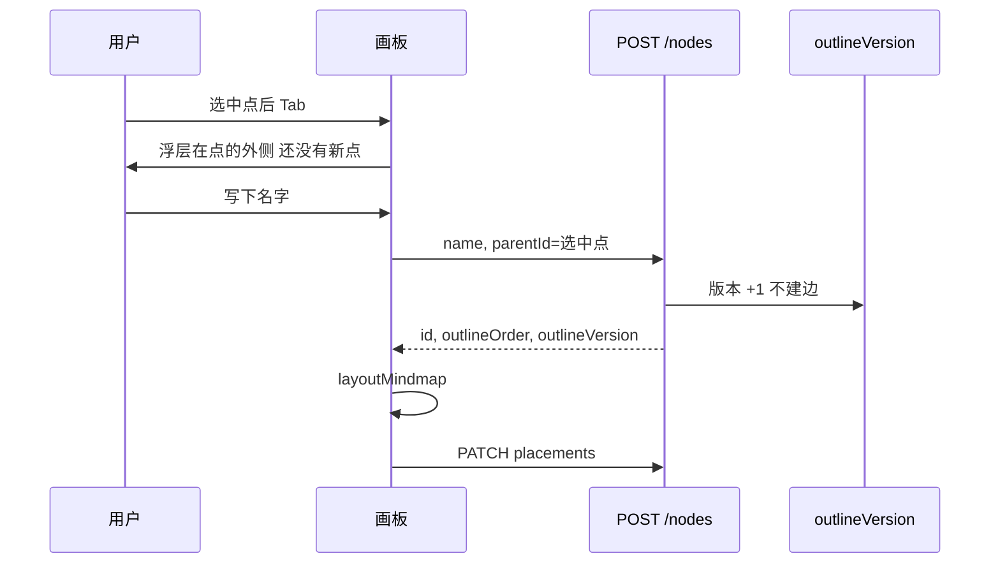
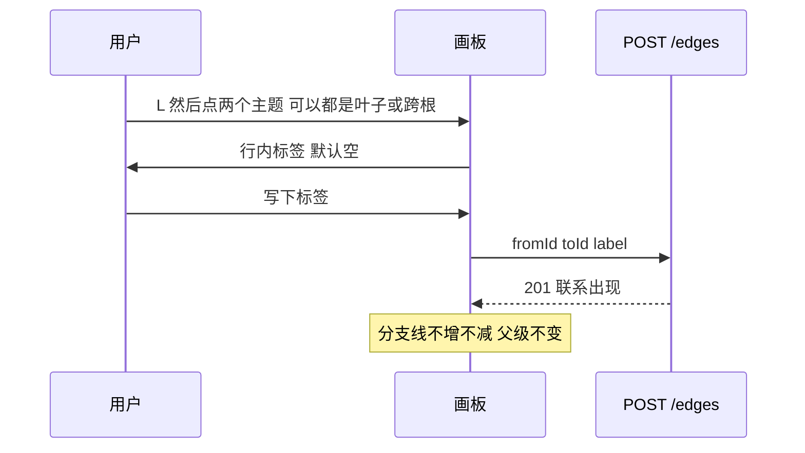

# 合集画板改成脑图

状态：Draft。待落地增量，不是现行行为。

日期：2026-11-17。
作者：待定。
读者：熟悉本仓库的工程师。

这是待落地增量。代码落地前，产品语义与实现仍以 `docs/prd/2026-10-25-graph.md` 和 `docs/tech/2026-10-25-graph.md` 为准。落地时，每一份改到用户可见行为的 PR 只把已经做了的句子写回基准。没做的不写。全部落地后这份增量退出。这一步只定规格，不改产品代码，也不改那两份基准。

对齐的是现行 Xmind 桌面版用户手册，不是 XMind 8。英文页正文没有印日期。中文联系页标注 2026-11-13。手册允许自定义快捷键。下表按手册上的默认键，并写明浏览器里不能占用的键。出处见文末。

---

## 概述

现行合集页 `/c/:id` 有两套互不驱动的组织：大纲树在成员关系的 `parentNodeId` 和 `outlineOrder` 上，画板是自由坐标。画板上新建点不连边，也不挂到当前选中点下面，服务端把它插成新的根。用户看到的是一张可摆放的图，不是脑图。

这一步只改合集画板的组织。父子仍用那棵大纲树，画板按树布局并画出分支线。分支线不是边。用户自己写标签的边留下，画成联系，用来连接任意两个主题，包括跨叶子、跨根。每个 `parentNodeId = null` 的成员是一个中心主题，同一张画布上分开铺，互不重叠。全貌页 `/library` 仍是合集图，继续自动排布，不改成脑图。

## 背景

现行已经具备这些事实，实现以代码和 2026-10-25 两份基准为准。

大纲在成员关系上，不在边上。`memberships.parentNodeId` 为空就是根，可以有多个根。`outlineOrder` 是同一父项下的顺序。同一合集里一个点只有一个大纲位置。`collections.outlineVersion` 防覆盖，`outlineInitialized` 为真后不再按创建时间把成员重排成根。纯规则在 `packages/dto/src/outline.ts`：`initialRoots`、`indent`、`outdent`、`moveSibling`、`promoteOnRemove`、`hasOutlineCycle`。服务端写入在 `apps/server/src/collections/outline.ts` 的 `putCollectionOutline`，锁合集行，拒绝自指和环。

画板坐标也在成员关系上：`x`、`y`、`z`、`imageWidth`。`layoutBoard`（`apps/web/src/features/board/board-layout.ts`）本身每次都按边重算一份坐标，不看数据库里有没有 `x`。真正「只给旧图一个起点」的是调用方：`collection-page.tsx` 约 117–132 行，在本合集每个直接成员的 `x` 都不是有限数时调用它并 `savePlacements`。约 134–148 行对展开的子集合做同样的事，但是写进子集合。有边且无环则从左到右分层，否则横排。记下之后调用方不再自动重排。基准写明：大纲不参与这次排布，也不从坐标或边反推大纲。

画布新建不写大纲父级。`collection-page.tsx` 的 `onGrowNode` 和 `onCreate` 调用 `library.createNode(collectionId, name)`，不传 `parentId`。`createCollectionNode` 把缺省父级当成 `null`，`placeAmong` 把新点排到该父项末尾。所以现行 Tab、Enter、双击空白、T 工具建出的都是新根，只是坐标落在旁边或点击处。图片点走 `POST /api/collections/:id/images`，父级也是根末尾。`onGrowNode` 用 `draft.groupId ?? pageId` 决定写进哪个合集。

边是账号级，不是合集级。`edges` 有 `user_id`，没有 `collection_id`。未删除行上 `(user_id, from_id, to_id, label)` 唯一（`edges_user_from_to_label_active`）。标签去空白后 1–40 字。禁止自环。`POST /api/edges` 用 `activeNodeIdSet` 确认两端都是当前用户未删除的点。`assembleCollectionGraph` 只取出两端都落在「本合集直接成员 ∪ 一层子集合直接成员」里的边，再分成父合集 `edges`、子集合内部边和 `bridges`。一端不在这个可见集合里的边不返回，边本身还在。

子集合是 `collection_inclusions`。展开时，子集合的点用自己的坐标加上锚点，画在父合集里（`projectCollection`）。收起时收成一个点，标识是 `inclusion:` 加子集合 id，`bridges` 改接到这个点上。点与合集之间没有边。子集合的大纲不复制进父合集。

合集页已经绑了 ⌘Z / ⇧⌘Z，而且不区分大纲和画板（`collection-page.tsx` 约 165–178 行）。工具条上的撤销和重做约 483–508 行，两边都调用 `useOutlineSession`。会话内部用一条 `tail` 把写入串起来（`outline-session.ts`）。栈在 `outline-history.ts`。`noteOutlineSuccess` 只收下 `structure` 和 `remove`。`type: 'create'` 会原样返回，不入栈。刷新即空。画板没有第二套栈。删除必须确认。检查器没开时 Delete / Backspace 不删除（`useAskDelete` 只挂在检查器上）。

`isFieldTarget`（`board-canvas.tsx`）把 `input`、`textarea`、`contenteditable`、`.tiptap` 和 `.usel` 都当成正在输入。`.usel` 是自定义下拉。

痛点：大纲和画板各说各话。Tab / Enter 的落点不是树的位置。跨叶子的知识边和将来的分支线如果画成同一种线，树和关系会混在一起。多个根在数据里已经合法，画板上只是一堆自由点，看不出多个中心主题。

## 目标与非目标

这一步做：

- 合集画板以大纲树为唯一父子结构，按树布局。
- 分支线和联系分开画、分开存。
- 多个根在同一张画布上作为多个中心主题铺开。
- 脑图编辑操作对齐下面的 Xmind 表，并写明和现行键冲突时以谁为准。
- 旧知识边全部留下，不从边或旧坐标反推父子。
- 结构操作走已经存在的那条会话栈。全局删除仍要确认。
- 只含根的多选可以一起平移锚点。

这一步不做：

- 不增加第五个名词。结构仍是合集、点、边、卡片。
- 不把分支做成一种边，不引入固定关系词，不预填「下一级」。
- 不恢复领域、点类型、扇区、能力、证据、FSRS、一跳星图。
- 不改全貌页。全貌继续 `layoutBoard`，没有画板工具栏。
- 不把子集合放进树。不在父合集上展开子集合的下一层。点与合集之间仍然没有边。
- 不在投影出来的子集合点上做脑图键和改父级。
- 不含非根的多选不能一起拖，也不能一起改父级。现行「框选后整组平移」只保留在全是根的时候。
- 不搬 Xmind 的主题皮肤、标记、任务、甘特图、演讲模式、录音、鱼骨图、时间轴、矩阵、组织架构图、自由改形状改颜色、外框、概要、标签贴纸。
- 不给文字点改宽、改颜色、改形状。宽仍是 168，无描述高 56，有描述高 74。
- 不拖联系的控制点，不给单条边单独改外观。
- 不把图片做成卡片。`kind: text | image` 仍是脸。富文本 `rich` 仍只挂在点上。
- 不把富文本编辑器里的撤销并进结构栈。
- 不做正式历史，不做跨刷新的撤销。
- 不做远程功能开关。不按合集留「仍用自由画板」。
- 不占用浏览器的刷新键：⌘R、Ctrl+R、⇧⌘R、Ctrl+Shift+R。

## Key Decisions

1. **父子只有大纲树。** 分支是 `parentNodeId` 的画法，不是 `edges` 里的一行。不建第二套父子。复用没有失败：多个根、防环、版本号、移出时子项提升都已经在这棵树上。
2. **联系可以连当前合集里任意两个不同的直接成员。** 包括非叶子、父子、不同根。不限制为叶子。用户说的「跨叶子」是要补上树表达不了的连法，不是把端点收成叶子。现行边本来就能连任意两点并挂卡片。静默改成「仅叶子」会藏起或拒绝已有边。不这么做。
3. **已有边全部留下，画成联系。** 包括标签恰好是「下一级」、且两端正好是父子的边。它们仍是边，不是分支。不删除、不改标签、不拿来生成 `parentNodeId`。
4. **多个根都是中心主题。** `parentNodeId = null` 的每个成员各长一棵子树。默认向右生长，根沿垂直方向堆叠，包围盒之间留 `rootGap`。不左右并排：向右生长时，左右并排会让后一棵树的根撞上前一棵树的叶子。用户拖根可以改锚点，拖开之后不再堆回去。根与根的顺序也可以拖到两个根之间的缝里，不只有 Alt+↑↓。
5. **默认朝向是向右。** 合集上可改成向左或两侧。记在 `collections.layout_direction`，不记在账号的 `canvas_grow` 上。`canvas_grow` 列和 `PATCH /api/me/canvas` 的 `grow` 留着，画板不再读它，属性里去掉「下级方向」。`canvasPrefsSchema` 仍是 `strictObject`，必须继续收 `grow`，否则旧页面整份提交会被拒绝。
6. **左右侧不由 `outlineOrder` 的奇偶决定。** 奇偶只在朝向第一次改成两侧时，给 `layout_side` 仍为空的根的直接子项写一次。之后同级排序不改这一列，拖拽改父级也不改，子树不换侧。要换侧用单独的「放到另一侧」。更深的点不存 `layout_side`，跟从根数下来第一个有 `layout_side` 的祖先。那个祖先被放到另一侧时，后代跟着走，因为它们本来就画在祖先那一侧。`layout_side` 是成员上的一列，不是边，也不是第五个名词。
7. **第一次打开旧画板就按树重排。没有「按脑图排列」按钮。** 重排和备份在同一次发布里。任何客户端在该合集 `adopt` 成功之前，不得把 `layoutMindmap` 的结果写入 `x`、`y`。`mindmap_anchored` 仍为假时，不得把现行 `x`、`y` 当成根锚点。非根的 `x`、`y` 只是缓存，画的时候不读。回滚只恢复备份列，不恢复后来的大纲编辑。见数据一节。
8. **子集合不进父树。** 边框、锚点、已经有坐标的内部点保持现行。投影点和收起的子集合芯片不做脑图键，也不做改父级。空白处和图片落在边框里，仍在子集合里新建根，不跑父树布局。父合集打开时，现行「子集合每个点的 `x` 都是空」那一次 `layoutBoard` 留下，只作为子集合自己的起点。父合集自己的那一次全空 `layoutBoard` 删掉。
9. **删除仍要确认。撤销不代替确认。** 全局删除会从所有合集去掉这个点，和 Xmind 删一个主题不是一回事。检查器没开时，Delete / Backspace 仍不删除。改父级、同级排序不确认，靠撤销。
10. **不新增画板快捷键监听。** ⌘Z / ⇧⌘Z 继续走 `collection-page.tsx` 里现有的那一个监听和 `useOutlineSession` 的队列。扩展 `noteOutlineSuccess`，让 `create` 入栈。插入父主题、刚创建的联系也入同一条队列。刷新即空。不记改名、描述、卡片、换图、富文本按键、折叠，也不记非根坐标缓存。根锚点的平移入栈。富文本仍用 Tiptap 自己的 history。联系刚建完可以撤销，撤销直接删这条边，不再问一次。检查器里主动删关系仍要确认。
11. **新建仍是写下名字才创建。** 接口不允许空名。不先插入占位主题。行内输入浮在选中点旁边，不占树的坐标。取消则不建点。这和 Xmind「先长出主题再打字」不同，以现行名字约束为准。
12. **折叠是本标签页的视图，不写坐标。** 画板用 `sessionStorage`，缺省全展开。不复用大纲的展开集合：大纲缺省是空集合，表示全折叠。画布永远用 `layoutMindmap` 的返回值来画，不用上次写下的非根坐标。折叠不调用 `placements`。

## 设计

### 树和联系



同一点在另一个合集有另一行 `memberships`，树、`layout_side` 和锚点都按合集算。改这个合集的父级不改另一个合集，也不改边。

分支线：箭头指向子主题，没有联系时无标签、单击不能选中、不能挂卡片。双击或右键这条线打开关系输入，写在曲线中点，保存的方向是从父到子。颜色用 `--mute`，1.25px 实线，线头是平的，停在箭头底部，底边中点和线尾重合。箭头顺着到达方向，不横插在弯线上。不读合集的 `appearance`（含「无箭头」），也不读账号的 `route`。不调用 `edgeDraw`。父子之间已经保存的联系改画在这条曲线上：标签在中点，箭头从 `from` 指向 `to`，线色跟随这条联系的外观，可点可选，双击仍改标签，输入框也在曲线中点。标签放不下时，这一父项到直接子项的距离按上面的 `levelExtra` 加宽。这条联系不再另画一条。没有联系时，箭头从父指向子。

几何在 `branch-geometry.ts` 的 `branchCubic(parent, child)`。不看朝向参数，只看两只盒子，这样自由坐标和排好的树用同一条规则。

- 任一盒子缺失：不画这一段。
- 出口在父盒子朝向子中心的那一条边上，取该边中点。入口在子盒子朝向父中心的那一条边上，取该边中点。哪一条边：`|dx| >= |dy|` 时看 `dx` 的符号，否则看 `dy`。向右长的树因此是父右缘到子左缘。向左是父左缘到子右缘。子在父上方、左方或互相重叠时同样按中心判断，不假定子在右侧。
- 三次贝塞尔。`P0` 是父出口，`P3` 是子入口。沿父出口外法线，子入口在前方的距离记为 `along`。`handle = clamp(端点距离 * 0.45, 24, 160)`；`along > 0` 时再不超过 `along / 2`，两个控制点不能交叉，曲线留在两点之间。`P1 = P0 + 父出口外法线 * handle`。外法线：右是 `+x`，左是 `-x`，下是 `+y`，上是 `-y`。到达方向先取父出口指向子入口的单位向量。它和「进入这一边」的夹角超过 55°，或根本不进入这一边时，改从进入方向朝连线转，最多 55°，避免箭头贴着边擦过。`P2 = P3 - 到达方向 * handle`。正对时到达方向就是进入方向，控制点和以前一样。箭头尖端在入口中点。线尾是曲线上离尖端一个箭头长度的点，箭头从线尾指向尖端，底边中点就是线尾。联系从子指向父时，把曲线反过来，箭头回到父。

现行 SVG 顺序是：子集合边框底层、`BoardEdges`、`BoardNodes`、子集合标题（`board-canvas.tsx` 约 1839–1923 行）。分支插在 `BoardEdges` 之前。联系仍在分支上面、点的下面。

折叠起来的点：子树不画，分支不画，布局不占位。联系的一端若被折进某个祖先，这一帧改接到最近的仍可见祖先，不改库里的 `from_id` / `to_id`。两端折到同一个可见点上时，这条联系这一帧不画。展开后再接到原点。规则和收起子集合时 `bridges` 改接到收起点上同一类，但是只影响画法。

### 布局函数

新纯函数 `layoutMindmap`，放在 `apps/web/src/features/board/mindmap-layout.ts`。不读 DOM，也不直接读边。父子联系要占的宽度由调用方放进 `levelExtra`。`layoutBoard` 留下给全貌，以及子集合全空时的那一次起点。合集画板自己不再调用 `layoutBoard`。

```ts
export type MindmapDirection = 'right' | 'left' | 'both';

export type MindmapNode = {
  id: string;
  parentId: string | null;
  order: number;
  /** 仅当父级是根且 direction 为 both 时读取。deeper 节点忽略。 */
  side: 'left' | 'right' | null;
  w: number;
  h: number;
};

export type MindmapInput = {
  nodes: readonly MindmapNode[];
  folded: ReadonlySet<string>;
  direction: MindmapDirection;
  /** 根盒子左上角。mindmap_anchored 为假时调用方传空 Map。 */
  anchors: ReadonlyMap<string, { x: number; y: number }>;
  rootGap: number;
  levelGap: number;
  siblingGap: number;
  originX: number;
  originY: number;
  /** 父项 id → 在 levelGap 之外再加的像素。没有这张表时全部不加。 */
  levelExtra?: ReadonlyMap<string, number>;
};

export type MindmapBox = { id: string; x: number; y: number; w: number; h: number };

export function layoutMindmap(input: MindmapInput): MindmapBox[];
```

常量：`rootGap = 96`，`levelGap = 72`，`siblingGap = 16`，`originX = 48`，`originY = 48`。

父子联系加宽。`levelExtra` 的键是父项 id。缺这张表、没有这个 id、值不是有限正数时，这一层只留 `levelGap`。同一父项的直接子项共用这一条加宽，左边缘仍对齐。加宽只来自画在这条分支上的联系：`branchLevelExtra` 看两端是不是这对父子，两个方向都算，取画出的标签里最宽的一条。画出的标签是 `shortLabel`。字宽 11px，码点不大于 `0xFF` 的按 6.6，其余按 11，总和向上取整，再加 16，让标签离开点和折叠圆。跨叶子的联系不加。父项折起来之后不再排子项，这条加宽也不占地方。向左和两侧都先按向右加上，再镜像。

尺寸由调用方算好再传进来。文字点宽 168，高用 `textNodeHeight`：空描述 56，有描述 74。图片点用 `imageFrame`。图还没加载完时比例按 1，高等于宽加名字行 22。宽或高不是有限正数时，整函数返回空数组。

无效输入返回空数组，调用方不写坐标：自指、环、`parentId` 不是 `null` 且不在这批 `id` 里。不把缺父的点悄悄当成根，也不只丢掉那一个点。

折叠：父项在 `folded` 里时，量布局把它当叶子。后代不进入返回值。

记 `kids` 为该父项的可见子项，按 `order` 升序，再按 `id` 升序。`n = kids.length`。子树高度里的缝是 `siblingGap * max(n - 1, 0)`。一个子项时缝是 0。没有子项时没有缝。

自底向上，向右（向左先按向右量）：

- 没有可见子项：子树宽 = 点宽，子树高 = 点高。
- 有可见子项：`stackH = Σ childSubtree.h + siblingGap * (n - 1)`。这一层的缝 = `levelGap` + 该父项的 `levelExtra`。子树宽 = 点宽 + 这一层的缝 + 这些子树宽的最大值。子树高 = `max(点高, stackH)`。

放下，子树盒子左上角是 `(left, top)`：

- 点的左上角：`nodeX = left`，`nodeY = top + (子树高 - 点高) / 2`。
- 有子项时，叠的顶是 `stackTop = top + (子树高 - stackH) / 2`。第 `i` 个子项（从 0 起）的 `childTop` 是 `stackTop` 加上它前面每个子树的高，再加上 `i * siblingGap`。子项的 `left` 是 `nodeX + 点宽 + levelGap + 该父项的 levelExtra`。然后递归。

向左：先按向右放，根的左上角临时在它的锚点。再绕根盒子的垂直中线镜像每个盒子的中心，不是绕整棵子树的中线，也不是镜像左边缘。根中心 `cx = root.x + root.w / 2`。每个盒子（含根）新的中心 `x' = 2 * cx - (box.x + box.w / 2)`，然后 `box.x = x' - box.w / 2`。根的中心不动，所以根留在右边，子项到左边。`y` 不变。

两侧：只把根的直接子项分到左或右。`side === 'left'` 在左，`'right'` 或 `null` 在右。`null` 在写路径上不应该出现；真出现时放右边，避免返回空数组把整张图藏掉。每一侧各自按上面的公式叠。子树高 = `max(点高, 左侧 stackH, 右侧 stackH)`。根在这块高度里垂直居中。左侧叠和右侧叠也各自在这块高度里垂直居中，不是两侧顶对齐。右侧子项的 `left` 仍是 `nodeX + 点宽 + levelGap + 该父项的 levelExtra`。左侧子项先按向右的公式得到相对坐标，再绕根的垂直中线镜像。更深的点不再另分左右，跟它那一侧的父项向同一方向长。

多个根：每个根先单独成树。`anchors` 里有的根，平移到该锚点（根盒子的左上角）。没有锚点的根按 `order` 往下堆：第一棵的根左上角是 `(originX, originY)`；下一棵的根 `x` 与 `originX` 对齐，`y` 在上一棵子树包围盒下沿再加 `rootGap`。若和已有锚点的包围盒相交，就继续往下推，直到分开。向左或两侧若使整体 `minX < originX`，只平移那些没有锚点的树，使它们的 `minX = originX`。已有锚点的根不参加这次平移。

数值例子。常量用上面的数。点都是文字点。

向右。根 R 168×56，子 A 168×56，子 B 168×74。`stackH = 56 + 74 + 16 = 146`。子树宽 = `168 + 72 + 168 = 408`，高 = `max(56, 146) = 146`。根锚点在 `(48, 48)`。R 的 `y = 48 + (146 - 56) / 2 = 93`，`x = 48`。叠的顶 = `48 + (146 - 146) / 2 = 48`。A 在 `(288, 48)`。B 在 `(288, 120)`。若 R 的 `levelExtra` 是 38（画出的「前提」宽 22，向上取整后仍是 22，再加 16），A 和 B 的 `x` 都是 `326`，`y` 不变，R 仍是 `(48, 93)`。

向左。先得到上面的坐标，根中心 `x = 48 + 84 = 132`。A 的中心 `x = 288 + 84 = 372`，镜像后中心 `x = 264 - 372 = -108`，A 的左边缘 = `-108 - 84 = -192`。B 的 `x` 同样是 `-192`，`y` 仍是 120。R 不动，仍是 `(48, 93)`。

两侧。R 168×56 在 `(48, 48)`。A 的 `side` 是 `right`，168×56。C 的 `side` 是 `left`，168×56。两侧 `stackH` 都是 56。子树高 = 56。R 的 `y = 48`。A 在 `(288, 48)`。C 先放在右侧公式的位置 `(288, 48)`，再绕 R 的中心 `x = 132` 镜像，左边缘 = `-192`，`y = 48`。

再加一个同在右侧的 D，168×56，排在 A 后面。右侧 `stackH = 56 + 16 + 56 = 128`。子树高 = `max(56, 56, 128) = 128`。R 的 `y = 48 + (128 - 56) / 2 = 84`。右侧叠的顶 = `48 + (128 - 128) / 2 = 48`。A `(288, 48)`，D `(288, 120)`。左侧 C 的叠在高度 128 里居中，`stackTop = 48 + (128 - 56) / 2 = 84`，镜像后 `y = 84`，`x = -192`。

让开子集合只在第一次无锚点布局里做，而且只做一次。纯函数 `separateFromObstacles(boxes, obstacles)`：障碍是展开子集合的 `inclusionFrameRect`，或收起时那个芯片盒子，同一个子集合只取一种。折叠芯片用 `projectCollection` 里收起点的盒子，不是展开边框。步骤：最多 `障碍数 + 1` 轮。算出森林包围盒。取第一块相交的障碍。`moveRight = 障碍.right + 24 - 森林.left`，`moveDown = 障碍.bottom + 24 - 森林.top`。哪个小就整森林加哪一个，只加正数。再测。清开了就停。轮数用完仍相交，就停在最后的位置，不再推。然后把每个根的左上角记成锚点。`mindmap_anchored` 为真之后不再调用。用户之后把根拖回去，允许和边框重叠。

调用方什么时候算、什么时候写。下面是 PR6 合并之后的合集画板。PR6 之前，合集画板仍用 `board-canvas.tsx` 里的 `layoutPlaced` 和 `layoutBoard`。PR3 在那之前只给新点写临时坐标，不重排其他点。这条临时规则在 PR6 合并后作废。

- 画：合集页每次用 `layoutMindmap` 画本合集的直接成员。输入是树、本标签页的折叠集合、朝向、根锚点。非根的库内 `x`、`y` 不传入。这些直接成员不进入 `layoutPlaced`，也不进入 `layoutBoard`。`x` 仍是 `null` 时也不进入。折叠只改这一次计算的输入，不写坐标。
- 现行 `board-canvas.tsx` 约 367–379 行：已有任一 `x` 时走 `layoutPlaced`，否则走 `layoutBoard`。约 1647–1688 行：还有点没有 `x` 时，量视野中心，再调用 `onPlaceUnpositioned`。`layoutPlaced` 在点都有 `x` 时仍把宽高写成 `NODE_W`、`NODE_H`（`board-layout.ts`）。描述 74 和图片框都会错。合集页对本合集直接成员短路这两处。`collection-page.tsx` 约 707 行的 `onPlaceUnpositioned` 丢掉 `home.groupId == null` 的点，不把它们写成视野中心的锚点。
- 全貌页 `/library` 仍用 `BoardCanvas`，继续 `layoutBoard`。不改。
- 投影点保持今天的摆放。已有坐标不动。展开的子集合每个点的 `x` 都空时，仍走 `collection-page.tsx` 约 134–148 行的 `layoutBoard`，写入子集合。缺坐标的投影点仍可走 `onPlaceUnpositioned`，写的是子集合自己的 placements。
- 写非根缓存和根锚点：首次 adopt 之后的那一次全展开布局、结构写入成功、朝向改变、描述提交成功、图片宽度提交成功、结构撤销或重做成功、根锚点拖动松手。这些写入都在 PR6。PR7 不另做一条写入，成功的撤销和重做只调用这一条。折叠不写。实时通知带来的重新读取不写。
- 首次那一次忽略本标签页已经折起来的点，按全展开写入，避免把折过的缓存当成唯一副本。写完之后本标签页再按自己的折叠画，不写。
- 图片改宽只更新 `imageWidth`，然后用原根锚点重算。不保留子项的自由偏移。根的左上角不动。
- 描述从空到非空，高度从 56 变成 74，同样重算。
- 不在 `pointermove` 里调用。拖根或拖整棵子树的预览只加位移。

写入用现行 `PATCH /api/collections/:id/placements`。`z` 保持原值，没有则写 0。差小于 0.5px 的不写。只写这次布局返回了的点。折起来因而没返回的点留着旧缓存，不改成 `null`。吸附打开时只吸附根锚点的左上角，步长仍是 16。算出来的子项不吸附。第一次自动布局不吸附。

实时通知：`shouldPublish` 对成功的非 GET `/api/` 写入都会发，`startLive` 会重新拉图。拉回来之后只更新树、朝向和根锚点。每个标签页用自己的折叠再算一遍来画，不 `PATCH`。因此两个标签页不会因为折叠互相覆盖。

500 个点时，这个函数是两遍树遍历，没有 DOM。预算是主线程 16ms。不在拖动过程中对整树重算。坐标写回是一次 `placements`。

### 多根怎么铺



新建根：

- 没有选中时，双击空白、T 工具、右键「新建根主题」：`parentId = null`，排在根末尾。锚点是点击处的左上角（沿用现在点击点减去半个文字盒的算法）。
- 选中一个根时按 Enter：新根插在这个根后面（`afterNodeId`）。锚点 x 与这个根相同，y 在它的子树下沿 + `rootGap`。
- 把非根拖到空白：该点变成根，后代仍挂在它下面。锚点是松手时的左上角。不能拖到自己的后代上。
- 把根拖到两个根的缝里：它仍是根，顺序改到这条缝，锚点改到松手位置。这不是只平移。
- 拖一个根到另一个点上：这个根变成那个点的最后一个子项，整棵原子树跟着走。锚点失效，改由布局算。
- I、拖入图片、⌘V：仍新建图片点，父级仍是根末尾。落点变成锚点。拖到已有点上仍是新建，不替换，也不变成那个点的子项。落在展开的子集合边框里时，仍建在那个子集合里，并且是那个子集合的新根。不进入父合集的树。

只含根的多选：拖动给每个根锚点加同一段位移，不改父级，不改顺序。选中里只要有一个非根、一个投影点、一个上传中的点或一个子集合芯片，这次拖动不改锚点，也不改父级。Tab、Enter、方向键在多选时仍然不做。

折叠一个根时，只收它的子树。别的根不动。折叠状态不写进 `memberships`，也不写 `placements`。

### 子主题怎么建出来

选中本合集的一个直接成员。投影点（`groupId != null`）和 `inclusion:` 芯片不进入这条路径。

Tab、Shift+Enter、Enter、⌘Enter / Ctrl+Enter 都先打开同一个行内输入。输入框是浮层，不插入树。

- 子主题：向右时，浮层左边缘 = 选中点右边缘 + 这一层的缝（`levelGap`，已有联系加宽时加上 `levelExtra`），垂直与选中点居中，和已有子项同一列。向左时贴在左缘外侧。两侧时贴在即将写入的那一侧。
- 同级之后：浮在选中点下方 `siblingGap` 处，左对齐。
- 同级之前：浮在选中点上方。
- 父主题：浮在选中点和它父点的中间。选中的是根时，浮在生长方向的反侧，距离 `levelGap`。

空名字或 Esc：不请求。写下名字才请求。PR6 接上之后，201 之后跑 `layoutMindmap` 并 `PATCH placements`，浮层消失，点出现在算出的坐标上。失败则浮层和名字留着。PR6 之前不跑这整棵树的布局，新点只写自己的临时坐标。



Enter 是同级之后：`parentId` 等于选中点的父级，`afterNodeId` 等于选中点。选中的是根时，这就是上面的新建根。

Shift+Enter 是同级之前。`beforeNodeId` 等于选中点，`parentId` 等于选中点的父级。不和 `afterNodeId` 一起传。

⌘Enter / Ctrl+Enter 是插入父主题。名字同样来自这个浮层。一次事务，不拆成「先创建再 PUT」：

`POST /api/collections/:id/outline/parent`，体是 `{ expectedVersion, nodeId, name }`。`name` 用和 `createNodeBodySchema` 一样的 trim，1–80 字。`lockCollection` 已有的 `FOR UPDATE` 锁住合集行。版本不符 409，不写。`nodeId` 不是本合集直接成员则 400 `invalid_body`。新点的父级和顺序占用原来选中点的位置。选中点改挂到新点下，`order = 0`。选中点原来的后代仍挂在选中点下。不建边。版本 +1。返回现行创建点的字段（含 `duplicates`）加上 `childId`（原来选中的点）。这次事务不按左右数量写 `layout_side`。被降级的点当时的父级是根时，把它那一列（含 `null`）抄到新点上。被降级的点自己是根，或它的父级不是根：新点写 `null`。被降级的那一行不改。它若不再是根的直接子项，布局不读它。这样左侧的分支仍在左侧。

`beforeNodeId` 的检查复制 `afterNodeId`。`placeAmong` 今天对不上的 `afterNodeId` 返回 `'after'`，路由把它变成 400 `invalid_body`。`beforeNodeId` 同样：必须是同一父项下的直接成员。未知 id、已删除、在别的父项下，都是 400 `invalid_body`。和 `afterNodeId` 同时出现也是 400 `invalid_body`。客户端 `createNode`（`apps/web/src/features/library/collections.ts`）的 `place` 增加可选 `beforeNodeId`，请求体里带上。服务端拒绝时走现有的 `apiRead` 错误文案，不另造一句。

两侧且新点的父级是根时，Tab、Enter、Shift+Enter 这些新长出来的子项，在创建事务里写 `layout_side`。数这个根下面已经有的左和右。哪边少放哪边。一样多放右边。不是两侧，或父级不是根，则写 `null`。插入父主题不走这句，见上面的抄列。拖拽改父级也不走这句。

### 联系怎么连

L 仍是联系工具，也是唯一的联系快捷键。英文手册的 Ctrl+Shift+R / ⇧⌘R 在 Chrome 和 Firefox 里是强制刷新。不绑定。不 `preventDefault` 这组键。Ctrl+R / ⌘R 同样不绑定。中文手册的 Ctrl+Shift+L / ⇧⌘L 也不绑定，因为 L 已经是连线工具。

两端规则：当前合集的两个不同直接成员。非叶子可以。父子可以。不同根可以。自己不行。子集合的收起点不能当端点。展开边框里的点属于子集合，连线改的是子集合里那两个点的边，沿用现行。不要求两端是叶子。投影点上按 L：若选中的是投影点，连线的合集上下文仍是那个子集合的成员，不把父合集 id 拿去当 `parentId`。

标签仍必填，1–40 字，行内写完才 `POST /api/edges`。取消不创建。重复仍是 409「这条关系已经有了」。最近用过的标签仍可点进空输入框，不自动提交，没有固定词表。



选中联系时 Enter 仍是改标签，不是新建同级。选中点时 Enter 才是同级主题。

一端不在当前画板可见集合里的边，继续不画。可见集合的定义不变：直接成员，加上展开或收起时投影里的一层子集合。`assembleCollectionGraph` 的过滤不改。

### 拖拽改父级

只对本合集的直接成员生效。`groupId != null` 的投影点、`inclusion:` 芯片、`uploading:` 前缀的点都不是改父级的对象，也不是新父级。投影点仍可按现行拖动，写的是子集合自己的 `placements`，不改父合集大纲，也不改子集合大纲。

预览：被拖的点连同它的可见后代跟着指针平移。其他点不动。不调用 `layoutMindmap`。不画插入线以外的整树。缝上显示一条 2px 的横线，位置在下面说的中点。

松手的优先级：

1. 缝。把同一父项下的可见子项按顺序排好，含 `parentId = null` 的根。相邻两只盒子的缝的中点是 `((上.底 + 下.顶) / 2)` 的那条水平线。指针到这条线的垂直距离小于 8，且指针的 `x` 落在两只盒子左右边缘的并集里，就插在这两者之间。子树比 `siblingGap` 高时仍用盒子边缘，不用 16 这个常数去找缝。根掉进两个根的缝里：仍是根，顺序变成这个下标，锚点用松手时的左上角。
2. 否则，指针落在某个点的盒子内部，且这个点不是自己、不是自己的后代、不是投影点、不是芯片、不是上传中：父级改成这个点，顺序为它子项的末尾。
3. 否则，指针在空白：非根变成新根，锚点为左上角。已经是根则只改锚点。
4. 指针落在芯片、上传中的点或自己的后代上：取消，回到拖之前的父级和坐标。不把这次当成空白。

客户端先用 `hasOutlineCycle` 挡住环。服务端 `putCollectionOutline` 再拒一次。失败则整笔回到松手前的树，坐标也不写。

松手不写 `layout_side`。改父级只走 `PUT /api/collections/:id/outline`，这一路不改这一列。落到某个根下面、成为它的直接子项时，保留拖之前的值。`null` 仍画在右侧，包括原来是根的点。已经是 `left` 或 `right` 的，不因为另一侧更少而改写。要换侧仍用「放到另一侧」。

结构写入、adopt、commit、撤销都进 `useOutlineSession` 已有的那条 `tail`。后一次等前一次。不并行 PUT。

### 折叠

键：`unfold.board-fold.v1:<collectionId>`。值是被折叠的 id 数组。缺省空，全展开。只留在这个标签页。大纲继续用 `unfold.outline-return.v1:<collectionId>`，两边互不改写。

有子项的点，在生长方向那一侧显示折叠按钮。折叠后按钮上是直接子项的个数。快捷键是一组切换：⌘/ 与 Ctrl+/，只折或展选中点的直接子树。手册上 Mac 的折叠是 ⌘+/，展开是 ⇧+/，Windows 两边都是 Ctrl+/。Unfold 用一组切换，不把 ⇧+/ 当成展开。⇧⌘/ 与 Ctrl+Alt+/ 对选中点的全部后代做一次切换。手册里「折叠全部」和「展开全部」写的是同一组键，这里不照搬成两个动作。大纲页不吃这两组键。投影点和芯片不折叠。

折叠只改 `sessionStorage` 和这一帧的画。不 `PATCH placements`。

### 和大纲页的关系

两边读写同一份 `parentNodeId`、`outlineOrder`、`outlineVersion`。大纲的键不改：结构模式关着时 Tab 留给浏览器，Enter 在非编辑时打开内容；结构模式里 Tab / Shift+Tab 仍是降一级和升一级。画板的 Tab 是新建子主题，不是把当前点降到前一个同级下面。

大纲里「保存名字后在同一父项后面新建一行」保持不变，和画板 Enter 的落点同一规则。那边新建的点，切到画板后按树出现。

### Xmind 操作对照

代际：现行 Xmind 桌面版用户手册。不是 XMind 8。XMind 8 只在和现行手册冲突时引用。

| 操作 | macOS | Windows | Unfold 这一步 | 和现行冲突时 |
| --- | --- | --- | --- | --- |
| 子主题 | Tab | Tab | 浮层写名，父级为选中点，排在子项末尾。不建边 | 以这一步为准。现行 Tab 是「在旁边新建」且不改父级 |
| 同级之后 | Return | Enter | 同一父级，排在选中点后面。选中根则是新根 | 以这一步为准。现行 Enter 是「在下方新建」且不改父级 |
| 同级之前 | Shift+Return | Shift+Enter | `beforeNodeId`。名字仍是单行 | 以这一步为准。现行手册把 Shift+Enter 写成主题内换行。XMind 8 才是插入前项。点的名字不能换行 |
| 父主题 | ⌘Return | Ctrl+Enter | 同一个浮层，然后 `POST .../outline/parent` | 现行没有这个键 |
| 改标题 | 手册是空格或双击 | 同左 | 双击，或 F2。空格不进入改名 | 以现行空格平移为准。按住空格拖动仍平移。F2 来自 XMind 8 快捷键表 |
| 沿树移动 | 手册未列方向键 | 同左 | 单选且是本合集直接成员时：生长方向进入第一个可见子项，反方向回到父级，上下是同一父项、同一侧的相邻可见同级。两侧时，向右只进右侧子项，向左只进左侧子项 | 以树为准。现行方向键按空间远近跳。这一条是脑图操作，不是从手册抄来的键 |
| 同级上移下移 | ⌥↑ / ⌥↓ | Alt+↑ / Alt+↓ | `moveSibling`。到头则不动。两侧时不改 `layout_side`，所以不换侧 | 现行画板没有这个键。不使用 Alt+←/→，避开浏览器后退 |
| 折叠 / 展开 | 手册折叠 ⌘+/，展开 ⇧+/ | 手册都是 Ctrl+/ | Unfold 用一组切换：⌘/ 与 Ctrl+/。全后代用 ⇧⌘/ 与 Ctrl+Alt+/ | 现行没有。这不是手册展开键的逐字复制 |
| 拖拽改父级 | 拖到别的主题 | 同左 | 单选，松手 PUT 大纲。不改 `layout_side`。预览是子树跟着走 | 现行拖动只改 `x,y`。非根改为改父级 |
| 拖到空白 | 自由主题 | 同左 | 变成新根，或根只改锚点。掉进根与根的缝里则改根的顺序 | 现行拖到空白只是换坐标 |
| 新建根 / 自由主题 | 双击空白 | 同左 | 新根，锚点在点击处 | 双击空白仍建文字点，但父级明确是根 |
| 联系 | 手册是 ⇧⌘R | 手册是 Ctrl+Shift+R | 只用 L | 这组 R 是浏览器强制刷新，不绑定，也不 `preventDefault`。L 以现行工具为准 |
| 删除主题 | Delete | Delete | 不直接删 | 以现行为准。检查器开着才弹出确认 |
| 删除单个主题并提升子项 | ⌘⌫ | Ctrl+Delete | 不绑定 | 移出当前合集仍走菜单和确认 |
| 撤销 | ⌘Z | Ctrl+Z | 现有监听，扩展后的栈 | 现行画板已经把这组键交给大纲栈。不添第二个监听 |
| 重做 | ⇧⌘Z | Ctrl+Shift+Z | 同一栈 | 现行手册是这组。不用 XMind 8 的 Ctrl+Y |
| 回到中心 | ⌘R | Ctrl+R | 不做 | 这是刷新。⇧⌘R / Ctrl+Shift+R 也不做 |

焦点判断复用 `isFieldTarget`，包含 `.usel`。为真时，上表里的结构键都不拦截，也不 `preventDefault`。⌘S 不在这张表里。现有保存路径在有修饰键时会先返回，结构键不得另写一个会吃掉 ⌘S 的监听。行内改名、改标签时 Enter 仍是提交这一行，不额外再插一个主题。`isComposing` 时不触发。多选时 Tab、Enter、方向键、Alt+↑↓ 都不改结构。选中子集合芯片时，Enter 仍是展开或收起，不新建主题。Esc 仍先关属性、菜单和进行中的拖动或连线，然后取消选中。V / T / I 仍是选择、文字、图片。

右键点菜单把「在旁边新建」「在下方新建」换成「子主题」「同级主题」「同级之前」「父主题」「建立联系」。两侧时根的直接子项多一项「放到另一侧」。空白菜单的「添加文字点」改成「新建根主题」。删除和移出仍在菜单底部，删除仍先确认。

## 接口

不改边的形状。`createEdgeBodySchema` 仍是 `{ fromId, toId, label }`。

`createNodeBodySchema` 增加可选 `beforeNodeId: uuid`。与 `afterNodeId` 互斥，同时出现是 400 `invalid_body`。`beforeNodeId` 必须是同一父项下的成员，否则同样 400 `invalid_body`。

新路由 `POST /api/collections/:id/outline/parent`。201 的体是现行创建点的字段加上 `childId`。409 的 `code` 仍是 `conflict`，文案仍是「大纲已经在别处改过，请刷新」。400 仍是 `invalid_body`。别的用户仍是 404 `not_found`。

新路由 `PATCH /api/collections/:id/layout`。体和响应都是 `{ direction: "right" | "left" | "both" }`，没有别的字段。不改 `outlineVersion`。朝向从别的值变成 `both` 时，对每个根的直接子项，若 `layout_side` 还是 `null`，按当时 `outlineOrder` 偶数写 `right`、奇数写 `left`，只写这一次。已有值不改。合集不存在 404。走现行实时通知。

新路由 `PATCH /api/collections/:id/members/:nodeId/side`，体 `{ side: "left" | "right" }`。只有父级是根时合法，否则 400 `invalid_body`。不改 `outlineOrder`，不改 `outlineVersion`。

新路由 `POST /api/collections/:id/mindmap-adopt`。锁合集。`mindmap_anchored` 已为真：不改任何行，返回 `{ mindmapAnchored: true, copied: 0 }`。为假：对 `free_captured = false` 的成员，把当前 `x`、`y` 抄到 `free_x`、`free_y`（允许两边都是 `null`），并把 `free_captured` 设为真。已捕获的行不覆盖。返回 `{ mindmapAnchored: false, copied }`。

新路由 `POST /api/collections/:id/mindmap-commit`。锁合集。已经为真：返回 `{ mindmapAnchored: true }`，不改行。否则若存在 `free_captured = false` 且 `x` 不是 `null` 的成员，返回 409 `conflict`，文案「旧位置还没记下来，没有重排」，不把旗标设为真。通过则设为真，返回 `{ mindmapAnchored: true }`。

`GET /api/collections/:id/graph` 增加 `layoutDirection`、`mindmapAnchored`。每个点增加 `layoutSide: "left" | "right" | null`。不返回 `free_x`、`free_y`、`free_captured`。

`PUT /api/collections/:id/outline` 的体和版本规则不变，也不改 `layout_side`。拖拽改父级、同级排序、撤销都走它。拖到根下成为直接子项时保留原值，`null` 画在右侧，含原来的根。不按左右数量重算。插入父主题抄 `layout_side` 只发生在 `POST .../outline/parent` 那一次事务里，不靠之后的 PUT。

`restoreOutlineBodySchema` 增加可选 `layoutSide: "left" | "right" | null`。缺省当 `null`，旧请求仍合法。`POST /api/collections/:id/outline/restore` 插入成员时写上这一列。现行 `MemberRestore` 已有 `nodeId`、`parentId`、`order`、`placement`、`children`（`outline-history.ts`）。撤销移出成员会删掉成员行，`layout_side` 跟着没了，所以快照里要带上这一列。`captureRemoval` 在移出前抄下它。

`users.canvas_grow` 不删。`canvasPrefsSchema` 仍收 `grow`。

## 数据

不加新表。

`collections` 加：

- `layout_direction text not null default 'right'`，只允许 `right`、`left`、`both`。
- `mindmap_anchored boolean not null default false`。

`memberships` 加：

- `free_x`、`free_y`，可空双精度。
- `free_captured boolean not null default false`。真表示这一行在旗标还没立起来时已经被抄过，以后的 adopt 不再抄它。
- `layout_side text null`，只允许 `null`、`left`、`right`。

迁移接在现行 `0017_outline.sql` 之后。已跑过的文件不再跑。

不从 `edges` 或旧坐标填 `parentNodeId`。`initialRoots` 的规则不动。

客户端在合集页上的顺序，放进现有的 outline 队列，不允许第二个 effect 并行：

1. `mindmap-adopt`。
2. 旗标仍为假时，用空锚点、空折叠做 `layoutMindmap`，再 `separateFromObstacles`，把根锚点设成推开之后的左上角。
3. `PATCH placements`。
4. `mindmap-commit`。
5. commit 若 409，再 adopt 一次并重试 commit 一次。仍 409 则停止，不把本地算出来的坐标当成锚点，提示「旧位置还没记下来，没有重排」。

`mindmap_anchored = false` 时，布局不读现行 `x`、`y`。commit 之后，根的 `x`、`y` 才是锚点。非根的 `x`、`y` 仍不是输入。

父合集那一段「全部 `x` 都是空就 `layoutBoard`」在同一次改动里删掉。否则它会在 commit 之后把按边分层的坐标写成锚点。子集合全空的那一段留下，见 Key Decision 8。

子集合已经有坐标的点，打开父合集时不写。

回滚不是把脑图期间的大纲编辑倒回去。只恢复备份下来的坐标，并清掉旗标。后来新建、还没 `free_captured` 的成员保持脑图坐标，会叠在恢复出来的旧图上。这是部分回滚。

```sql
UPDATE memberships AS m
SET x = m.free_x,
    y = m.free_y
FROM collections AS c
WHERE m.collection_id = c.id
  AND c.mindmap_anchored = true
  AND m.free_captured = true;

UPDATE collections
SET mindmap_anchored = false
WHERE mindmap_anchored = true;
```

`free_captured` 为真且 `free_x` 为 `null` 的行，会回到没有坐标的状态。没有界面按钮。不跑这段 SQL 就只回滚代码的话，画面停在最后一次脑图坐标上，手摆位置还在 `free_x`、`free_y` 里。

## 备选

**只加一个「按脑图排列」按钮，平时仍自由摆放。** 不改 Tab / Enter 的含义，旧图也不会被打开时重排。代价是画板继续有两套组织。按钮按下去的结果在下一次拖动后又散掉，除非之后禁止自由拖。不选。第一次打开就重排，不再留这个按钮。

**把父子做成一种边。** 不选。边是账号级的，同一对点加同一标签只能有一条，而且可以挂卡片。一个点在两个合集里父级不同，边做不到。现行大纲已经是成员关系。已有的「下一级」边也不能被收成结构。

**联系只允许叶子。** 不选。和 Xmind 的 Relationship 相反，也和现行 `POST /api/edges` 相反。跨叶子是要支持的情况，不是端点上限。

**只持久化根锚点，非根的 `x`、`y` 保持 `null`。** 画的时候本来就重算，缓存看起来多余。不选。现行不少路径把 `x` 为 `null` 当成「还没摆过」：父合集打开时的 `layoutBoard`、未摆放的点落在视野中心。非根若一直是 `null`，这些路径会把脑图点再摆一次。所以非根仍写出缓存，但布局不读它。回滚读的是 `free_x`，不是这份缓存。

## 安全

账号隔离沿用现行写法。

- 父级必须是本合集另一名直接成员。`putCollectionOutline` 和 `placeAmong` 已拒绝自指、环、以及不在成员列表里的父级。别的用户的点 id 到不了这行成员里。
- 插入父主题走同一把合集锁和 `expectedVersion`。不能把 `nodeId` 写成别的合集或别的用户的点。
- `beforeNodeId` 不是同一父项的成员时 400，不写。
- 联系仍走 `POST /api/edges`。两端都要在 `activeNodeIdSet` 里。不能连到别人的点。
- `layout`、`side`、`mindmap-adopt`、`mindmap-commit` 都先按现行合集查询确认 `user_id`。别人的合集 404。
- `free_x` 和 `free_captured` 不进 graph 响应。
- 子集合的放入环检测不改。脑图父级不指向合集 id。

## 观测

这一步不加指标平台。

保存状态仍是操作区上的未保存、保存中、保存成功、保存失败。结构写入继续包在 `LibraryService` 的写入计数里。失败不自动重试。断网不得显示保存成功。

版本冲突仍是 409 `conflict`，接口文案「大纲已经在别处改过，请刷新」。页面上仍用现行那句「另一台设备改动过这份大纲」。409 不改行，撤销栈不弹出。commit 的 409 用另一句「旧位置还没记下来，没有重排」，避免和大纲冲突混在一起。

`apps/server/src/app.ts` 里 Fastify 是 `logger: false`，所以不走 `app.log`。adopt 成功抄写时打一行 `console.info`，形如 `mindmap-adopt collection=<id> copied=<n>`。commit 把旗标从假改成真时打一行 `mindmap-commit collection=<id>`。只含合集 id 和行数，不含坐标、标题或用户名。这两行要留下，不是调试残留。别的路径不打。

## 发布

没有功能开关。不按合集记「仍用自由画板」。

`main` 会构建镜像。因此：

- PR1 没有行为，可以先进入 `main`。
- PR2 到 PR5 可以独立审查，但不得在 PR6 之前进入 `main`。PR2 的分支线会穿过还没重排的自由坐标，不能当成对用户的一次发布。
- PR6 是对用户的脑图发布，不只是打开时的那一次写入。同一份里有：备份列、adopt、commit、删掉父合集全空 `layoutBoard`、合集画板改由 `layoutMindmap` 绘制、对本合集直接成员短路 `layoutPlaced`、`layoutBoard` 和 `onPlaceUnpositioned`，以及之后的结构、朝向、描述、图片宽度、根锚点松手写入。没有「先上重排、后补备份」。也没有「打开时像脑图，下一次 Tab 只挪新点」。

回滚是回滚代码，加上数据一节的 SQL。SQL 不撤销 Tab、插入父主题和新成员。桌面壳加载同一份站点，不改 Tauri。

## 测试

布局，新文件 `apps/web/src/features/board/mindmap-layout.test.ts`：

- 向右的数值例子：R、A、B 的 `x`、`y` 与上面一致。一个子项时缝是 0。没有子项时子树高就是点的高。
- 向左：中心镜像之后 A 的 `x` 是 `-192`，R 不动。
- 两侧：用 `side` 而不是奇偶。把 A、D 的 `order` 对调后，它们仍在右侧，只是上下交换。C 仍在左侧。
- 折叠集合里的点，其后代不在结果里，后面的同级向上补位。
- 两个根的包围盒垂直分离，间距不少于 `rootGap`。带锚点的根留在锚点。
- 调用方传入 `textNodeHeight('') === 56` 和 `textNodeHeight('有') === 74` 时，同级被拉开。传入 `imageFrame(220, 1)` 和 `imageFrame(440, 1)` 时，更宽的图片把下一级的 `left` 推远。测试直接调用这两个现行函数，不只手写宽高。
- `parentId` 指向不在输入里的 id、自指、环，都返回空数组。
- `separateFromObstacles`：一块相交的障碍按较小的正方向推开，间隙 24。收起芯片的矩形和展开边框都能挡住。轮数用完仍相交则停止。
- 不在这个文件里卡 16ms。500 点只断言每个点都有坐标、父子相对方向正确。

分支几何，新文件 `branch-geometry.test.ts`：

- 子在父右侧：父右缘中点到子左缘中点，控制点沿 `+x` / `-x`。箭头尖端在子左缘，笔画在尖端前停下，线尾是箭头底边中点。
- 子在右侧但高出很多：出口仍水平离开，箭头朝向子，不折成水平。
- 子在父左侧：父左缘到子右缘。
- 子在父上方：父上缘到子下缘。
- 两盒重叠：仍按中心选出口，不抛错。
- 缺一只盒子：返回空路径。

键位，新文件 `mindmap-keys.test.ts`。纯函数的输入带「是否字段焦点」。字段焦点为真时（调用方用 `isFieldTarget`，含 `.usel`）Tab、Enter、方向键、⌘Z 都是空命令。多选时 Tab 和 Enter 为空。选中边时 Enter 是改标签。选中点时 Enter 是同级之后。投影点上 Tab 是空命令。

菜单：改 `board-menu.test.ts` 的文案断言。

大纲纯函数：`packages/dto/src/outline.test.ts` 补 `beforeNodeId`。未知 id 和不同父项由服务端测，不在纯函数里访问数据库。

历史栈：`outline-history.test.ts` 补 `create` 入栈、插入父主题、联系创建、根锚点。409 不弹出。重建后栈空。富文本不在这个文件里。

服务端集成，扩展 `apps/server/src/collections/outline.integration.test.ts`。合集和点用 `randomUUID()`。登录用 `SEED_USERNAME` 和 `SEED_PASSWORD`。结束时删掉用例创建的合集和点。

- 子主题创建后父级正确，边的数量不增加。
- `beforeNodeId` 插到第一项。和 `afterNodeId` 同时出现是 400 `invalid_body`。`beforeNodeId` 不是同一父项的成员也是 400 `invalid_body`，版本不变。
- 插入父主题后，原选中点是新点的唯一子项，版本加 1，不建边。过期 `expectedVersion` 是 409，父级不变。返回含 `duplicates` 和 `childId`。被降级的点原来在左侧时，新点的 `layout_side` 仍是 `left`，不因另一侧更少而改成 `right`。被降级的那一行可以仍是 `left`，但布局不读。撤销后再重做走 `outline/restore`，成员 id 与第一次 201 相同，`layout_side` 仍是 `left`。不出现第二个点。
- 别的用户访问是 404。
- 改父级不删已有边。`moveSibling` 不改 `layout_side`。把点拖到另一个根上、成为它的直接子项时，`layout_side` 也不变：原来是 `left` 仍是 `left`；原来是根、这一列为 `null` 的，拖下去后仍是 `null`，画在右侧。`PUT` outline 不改这一列。
- 第一次改成 `both` 时，空的 `layout_side` 按当时顺序写一次。第二次 PATCH 不覆盖。
- adopt 把坐标抄进 `free_x`，并把 `free_captured` 设真。第二次不覆盖。旗标已真时再 adopt，`copied` 是 0，后来新建的成员不会被抄进 `free_x`。
- commit 在存在「`free_captured` 为假且 `x` 非空」时 409，旗标仍为假。通过之后为真。
- 非叶子之间的联系仍 201。自环 400。重复标签 409，`code` 是 `conflict`。

前端还有一条：投影点上的 Tab 不调用父合集的大纲接口。放在键位纯函数里断言命令为空，并在 `collection-page` 的调用说明里写死：命令为空就不请求。

`board-layout.test.ts` 保持通过。全貌仍走 `layoutBoard`。

## 风险

| 风险 | 程度 | 缓解 |
| --- | --- | --- |
| 重排发生在备份之前，回滚 SQL 恢复的是脑图坐标 | 高 | 第一次写脑图坐标的发布就是 PR6，同一份里先 adopt。commit 发现还有未捕获且已有 `x` 的行就 409。PR3 在 PR6 之前不重排其他点。PR5 不写 placements。画法和之后的重排都在 PR6，且在 adopt 之后 |
| 发布后 Tab 或拖拽只改新点，缺 `x` 的点被 `layoutPlaced` 冻在视野中心 | 高 | PR6 让直接成员只走 `layoutMindmap`。`onPlaceUnpositioned` 不写 `home.groupId == null` 的点。投影点仍走今天的摆放 |
| 回滚不能撤销脑图期间的改父级和新成员 | 高 | 数据一节写明是部分回滚，并给出 SQL。新成员 `free_captured` 为假，不参与写回 |
| 两个标签页同时打开未锚定的合集，各写一份布局 | 中 | 只有合集页上的那一条队列跑 adopt、placements、commit。折叠不写。重新拉图不写 |
| 父合集全空 `layoutBoard` 在 commit 之后把按边的坐标冻成锚点 | 高 | PR6 删掉 `collection-page.tsx` 117–132 行那段。子集合全空的 134–148 行留下，并写进规格 |
| 大纲版本冲突 | 中 | 沿用队列和 `expectedVersion`。409 不落地，栈不弹出 |
| 500 个点堵主线程 | 低 | 预算 16ms。拖动中不重算整树 |
| 子集合边框和树重叠 | 中 | 只在第一次无锚点布局调用 `separateFromObstacles`。之后允许重叠 |
| 嵌入框里的子集合在被打开前仍是自由坐标或按边的起点 | 中 | 不进父树。全空才有现行那一次 `layoutBoard`。已有坐标不改 |
| 两侧排序或拖拽把分支换到另一侧 | 中 | `layout_side` 不跟 `moveSibling` 走，拖拽改父级也不改。只有「放到另一侧」才换。`null` 画在右侧 |
| 联系和分支被看成同一种线 | 中 | 没有联系的分支用 `--mute`、无标签、不能选中，画在 `BoardEdges` 下面。父子联系画在同一条曲线上，带标签和外观色，不再另画一条 |

## 参考

- 现行产品：`docs/prd/2026-10-25-graph.md`。
- 现行实现：`docs/tech/2026-10-25-graph.md` 第 4、5、7 节。
- 大纲规则：`packages/dto/src/outline.ts`。写入：`apps/server/src/collections/outline.ts`。
- 全空才排布的调用方：`apps/web/src/features/collection/collection-page.tsx` 约 117–148 行。`layoutBoard` 本身在 `board-layout.ts`。
- 现有撤销监听和工具条：同一文件约 165–178 行、483–508 行。栈：`outline-history.ts` 的 `noteOutlineSuccess`。队列：`outline-session.ts`。
- 画布创建未传父级：同一文件的 `onGrowNode`、`onCreate`。`groupId ?? pageId`。
- 字段焦点：`board-canvas.tsx` 的 `isFieldTarget`，含 `.usel`。
- 现行自由摆放：同一文件约 367–379 行的 `layoutPlaced` / `layoutBoard`，约 1647–1688 行的视野中心和 `onPlaceUnpositioned`。合集页回调约在 `collection-page.tsx` 707 行。全貌页 `library-page.tsx` 仍用 `BoardCanvas`。
- SVG 顺序：同一文件约 1839–1923 行。
- 实时通知：`apps/server/src/sync/notice.ts` 的 `shouldPublish`。前端 `startLive`。
- 图的边怎么筛选：`assembleCollectionGraph`。投影：`inclusion-view.ts` 的 `projectCollection`。
- 边表：`apps/server/src/db/schema.ts` 的 `edges`、`memberships`。
- 进程日志是关的：`apps/server/src/app.ts` 的 `Fastify({ logger: false })`。
- Xmind 主题。Shift+Enter 在这一页是换行：<https://xmind.com/user-guide/topic-editing-new>
- Xmind 折叠。Mac 折叠是 ⌘+/，展开是 ⇧+/。Windows 都是 Ctrl+/。全部后代是 ⇧⌘+/ 与 Ctrl+Alt+/：<https://xmind.com/user-guide/fold-unfold-subtopic-new>
- Xmind 联系。任意两个主题。英文手册快捷键是 Ctrl+Shift+R / ⇧⌘R：<https://xmind.com/user-guide/relationship-new>
- 中文联系页写成 Ctrl+Shift+L / ⇧⌘L，页上日期 2026-11-13：<https://site.xmind.cn/user-guide/relationship-new>
- XMind 8 快捷键表，只作对照：<https://xmind-help.github.io/en/shortcuts.html>
- XMind 8 的 Relationship：<https://xmind-help.github.io/en/relationship.html>

## Open Questions

没有留着的产品分叉。第一次打开就重排，联系可以连任意主题，投影点不做脑图键，左右侧用 `layout_side` 而不是奇偶。这些都已经写在 Key Decisions 里。

## PR Plan

每份可以单独审查。除 PR1 外，PR2 到 PR5 不要在 PR6 之前合并进 `main`。`main` 会构建镜像。基准只在该 PR 已经改了的行为上动对应句子。没做的行为不写进基准。

### PR1 布局纯函数

- 标题：加上 `layoutMindmap`、`separateFromObstacles` 和分支几何，不接画布。
- 文件：`apps/web/src/features/board/mindmap-layout.ts`，`mindmap-layout.test.ts`，`branch-geometry.ts`，`branch-geometry.test.ts`。
- 依赖：无。
- 摘要：按上面的公式和数值例子实现。`layoutBoard` 不动。没有界面变化。可以进入 `main`。

### PR2 在现行坐标上画分支

- 标题：合集画板按大纲画出分支线，不写坐标。
- 文件：`board-canvas.tsx`。分支组件放在 `apps/web/src/features/board/`，插在 `BoardEdges` 之前。
- 依赖：PR1。
- 摘要：用现行盒子和 `branchCubic` 画分支。缺盒子的不画。不调用 `layoutMindmap` 写回。不改创建。这不是对用户的一次发布，线会穿过自由摆放的点。不要单独进 `main`。

### PR3 结构键和拖拽

- 标题：画板的新建和拖拽改大纲，但不重排整张图。
- 文件：`packages/dto/src/outline.ts`，`packages/dto/src/graph.ts`，`apps/server/src/collections/outline.ts`，`apps/server/src/collections/routes.ts`，`board-canvas.tsx`，`mindmap-keys.ts`，`apps/web/src/features/collection/collection-page.tsx`，`apps/web/src/features/library/collections.ts`，`outline.integration.test.ts`。菜单文案不在这里改。
- 依赖：PR1、PR2、PR4。PR4 先改菜单，避免两份 PR 同时改 `board-menu.ts`。
- 摘要：Tab、Enter、Shift+Enter、⌘Enter 按浮层和父级规则请求。`beforeNodeId` 和 `POST .../outline/parent` 在这里加上。这一份还没有 `layout_side` 列，插入父主题只改树，不写左右侧。抄列在 PR5。单选拖拽 PUT 大纲。在 PR6 合并之前，新点只写自己的临时坐标，位置用浮层或落点，不调用 `layoutMindmap` 改其他点的 `x`、`y`。这条在 PR6 合并后作废，结构成功改为调用 PR6 的布局写入。投影点不发父合集大纲请求。大纲页的键不改。多选不改结构。基准只改「Tab / Enter 的含义」和「拖拽可以改父级」这几句，不写重排。

### PR4 联系和分支分流

- 标题：联系保持为边，分支不可点，菜单改成建立联系。
- 文件：`board-edges.tsx`，`board-canvas.tsx`，`board-menu.ts`，`board-menu.test.ts`。
- 依赖：PR2。要在 PR3 之前合并，或和 PR3 放在同一分支上且先合这一份。
- 摘要：分支没有命中区域。只有 L 进入现行连线。不绑定 ⇧⌘R / Ctrl+Shift+R。端点仍是任意两个不同的点。不删边。折叠时联系改接到可见祖先，只改这一帧。基准只改右键菜单里连线的名字。

### PR5 朝向和左右侧

- 标题：合集可以保存朝向和 `layout_side`，仍不重排。
- 文件：迁移（`layout_direction`、`layout_side`），`schema.ts`，graph 响应，`PATCH .../layout`，`PATCH .../side`，`board-settings.tsx`。
- 依赖：PR1、PR3。插入父主题的路由在 PR3，抄列要改到那个事务上。
- 摘要：默认向右。属性里用「向右 / 向左 / 两侧」替换「下级方向」。`canvas_grow` 仍在偏好接口里，画板不读。Tab、Enter、Shift+Enter 新长出的子项按左右数量写 `layout_side`。拖拽不写这一列。插入父主题不计数：被降级的点当时父级是根时，把它的 `layout_side` 抄到新点上，含 `null`。否则新点写 `null`。这一份不读 `x`、`y` 当锚点，也不写 placements。真正铺开在 PR6。基准只改属性里「下级方向」那一行，注明画板还没按朝向重排，直到 PR6 把那句换成已经重排。

### PR6 旧图迁移、绘制和之后的重排

- 标题：备份旧坐标，合集画板改按树绘制，并在结构变化后再重排。
- 文件：迁移（`free_x`、`free_y`、`free_captured`、`mindmap_anchored`），adopt 与 commit 的服务端实现，`board-canvas.tsx`，`collection-page.tsx`（队列、117–132 行的删除、约 707 行回调的过滤、描述和图片宽度提交后的重排），`mindmap.integration.test.ts` 或 `outline.integration.test.ts`。
- 依赖：PR3、PR5。没有父级写入和朝向时不要重排。画布文件 PR2 已经改过，这一份接着改绘制。
- 摘要：数据一节的顺序。commit 的 409 按「未捕获且已有 x」判断。`console.info` 两行在这里加上。本合集直接成员只按 `layoutMindmap` 画，读取 `unfold.board-fold.v1`，不读非根的库存坐标。不把它们送进 `layoutPlaced` 或 `layoutBoard`，也不让 `onPlaceUnpositioned` 写它们。全貌页仍走 `layoutBoard`。投影点仍走今天的摆放，子集合 134–148 行不删。结构写入成功、朝向改变、描述提交、图片宽度提交、根锚点松手，都在这一份里布局并写 placements。折叠和实时重拉不写。PR3 的「只写新点临时坐标」从这一份起作废。基准改「打开画板按大纲布局、非根坐标是缓存、根坐标是锚点、之后的结构变化会重排」。这一份才是对用户的脑图发布。

### PR7 会话内结构撤销

- 标题：扩展现有大纲栈，不添画板监听。
- 文件：`outline-history.ts`，`outline-history.test.ts`，`outline-session.ts`，`collection-page.tsx` 里现有的撤销调用。不新增 `keydown` 监听。
- 依赖：PR3、PR6。撤销若会写整树坐标，必须发生在备份已经能用之后。
- 摘要：只加历史记录，不新增布局写入，也不新增 `keydown`。记录都走现有 `tail`。成功之后若要重排，调用 PR6 那一条。`structure` 沿用现行。`create`：撤销是移出这一处成员，重做是 `outline/restore`，快照里的 `layoutSide` 写回成员行。`insert-parent`：撤销是移出新点，让 `promoteOnRemove` 把原来的子项抬回去。移出前按 `captureRemoval` 记下 `nodeId`、`parentId`、`order`、`placement`、唯一子项，外加 `layoutSide`。重做是 `POST .../outline/restore`，用同一个 `nodeId`，子项仍是原来的点且 `order = 0`。不再调用 `POST .../outline/parent`，否则会新建第二个点。`edge-create`：记下 `edgeId`、`fromId`、`toId`、`label`；撤销是 `DELETE /api/edges/:id`，不再确认；重做是同一个 `POST`。根锚点是 `{ kind: 'anchors', before, after }`，撤销和重做都写这些根的 `placements`。结构、新建、插入父主题、锚点在成功之后调用 PR6 的布局写入。联系的撤销不调用它。父子联系的标签另按 `levelExtra` 加宽缝，见布局一节。409 不弹出，与 `outline-session.ts` 一致。全局删除仍要确认。焦点在字段里时现有监听已经返回。基准补一句：画板结构撤销就是这条栈，插入父主题的重做恢复同一个点，刷新即空。

### PR8 核对基准

- 标题：核对两份基准没有把未发布的行为写成现行。
- 文件：`docs/prd/2026-10-25-graph.md`，`docs/tech/2026-10-25-graph.md`。
- 依赖：已经合并的用户可见 PR。没合并的不在这里补写。
- 摘要：这一份不引入新行为。只检查 PR3、PR4、PR5、PR6、PR7 各自写回的句子和代码一致。仍不做的项留在「当前不做」：不经确认的删除、全貌脑图、主题皮肤、从边反推大纲、含非根的多选平移。
